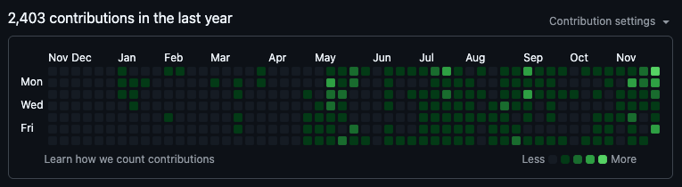
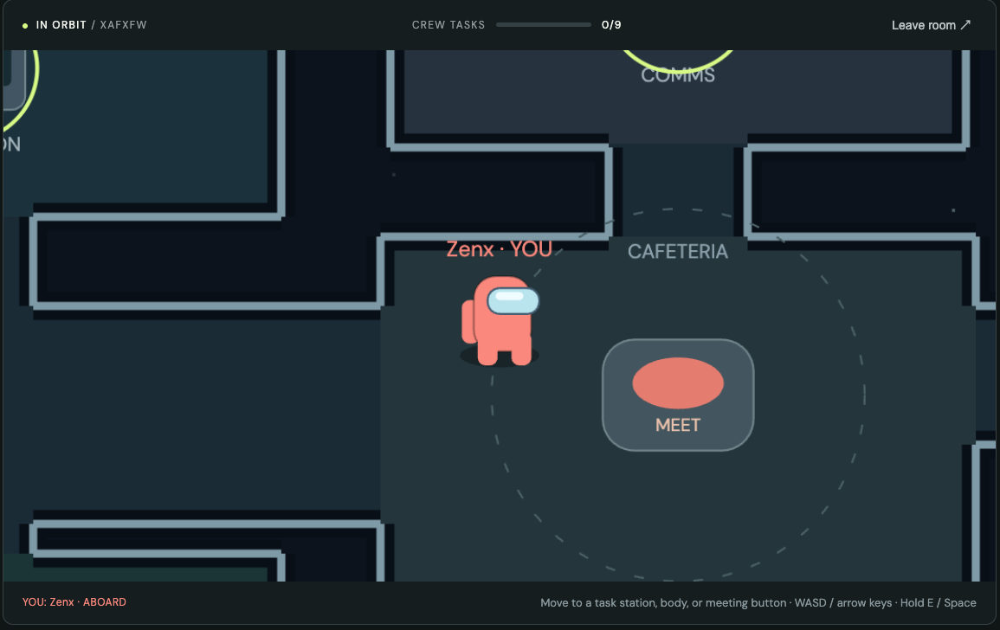
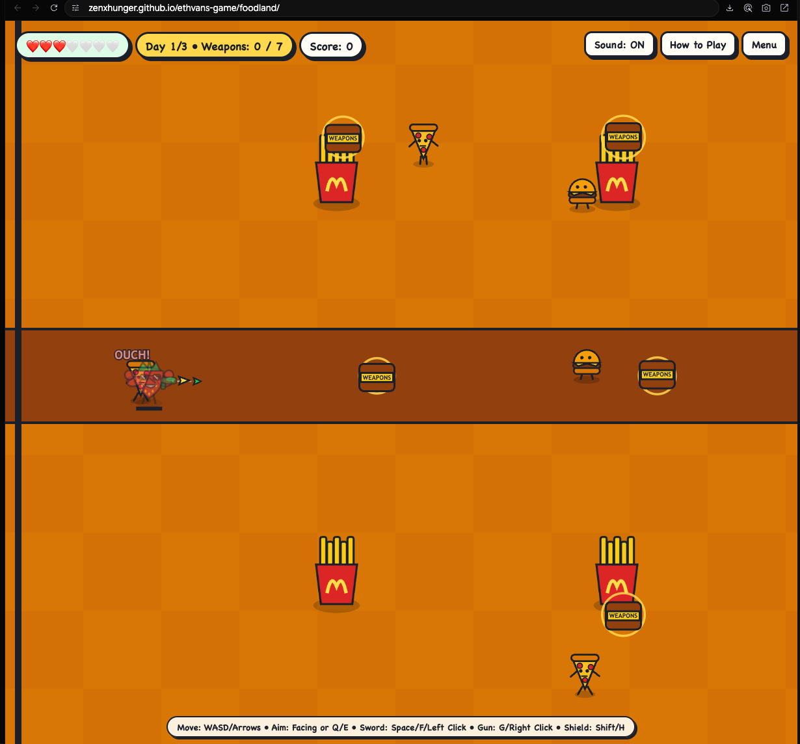

<!-- 待定稿项：1) 补四字统领词标题与封面图 cover；2) 确认 9 月模型对外统一写 Astra 还是 GPT-6；3) 补全下方教育思考第 2–5 点 -->

今年花了两个下午，我带着两个外甥（一个 9 岁，一个 7 岁），分别用 ChatGPT 和 Gemini 做了两款可以联机玩的游戏（在线合集：[Ethvan's Game](https://zenxhunger.github.io/ethvans-game/)）。整个过程像一扇小窗户，让我从一个很具体的切面，亲身感受到时代的变化，以及变化里属于个人的机会。

事情要从今年年初说起。工作之余，我开始用 AI 做各种 side project——从这个个人网站起步，一路做到个人财务管理面板、德州扑克复盘工具，再到半自动化的内容创作工作流。从最初体验 Claude Code，到各家陆续推出桌面端 Agent 工具，再到意识到不同模型各有长处，索性把 Grok、ChatGPT、Gemini 和 Claude 的订阅买了个全；临近年底赶上 Google 模型发布的小高潮，现在主力用的是 Antigravity 加 Neon。这个过程让我实实在在地尝到了创造的乐趣（把乐趣转化为生产力与收入的路还在走），也不知不觉把过去每周三次的德州扑克，换成了和 AI 一起学习、造东西——真心觉得，这是更好的消遣。

## 第一次：九月，把 *Among Us* 搬进客厅

九月去我姐家串门，我自然也把主机带了过去。两个外甥凑过来围观，我顺口问要不要一起做个游戏。他们开心地答应，马上问能不能做一个 *Among Us*。当然可以。当时正好赶上 Astra（<!-- 待确认：对外写 Astra 还是 GPT-6 -->）刚发布，我刚买了 ChatGPT 订阅，正好拿来试试手。

大外甥已经会打字了。我建好项目目录，引导他自己把想法敲进输入框。这是我们的第一条 prompt：

> "Build a game: There is an imposter and everyone else needs to do their task and find out who the imposter is before the imposter kills everyone. Everyone else beside the imposter are called crewmates. There is a button and when someone presses the button, everyone gathers around the button to discuss who they think is the imposter. Also, when someone is killed, and someone finds their body, they report it and everyone gathers around the button to discuss. There are tasks everyone beside the imposter does. Their are two ways the imposter loses, one of them is if they find out who the imposter is. Another way is everyone finishes their tasks before the imposter kills everyone. Can you support multiplayer mode where players sharing the same monitor and keyboard?"

除了最后一句是因为当时只带了一套键鼠、由我提醒他补上之外，整段规则全是他自己定义的。那一刻我其实挺惊讶：一个 9 岁的孩子，对角色概念（crewmates / imposter）的把握、对游戏流程和胜负条件的逻辑梳理，已经非常清晰。我不太确定自己 9 岁时能不能做到这种程度的表达——这背后或许也有所谓「英文思维」或表达训练的影响，值得以后再深究。

当时 Codex 跑得还比较慢。等待的间隙，我顺势启发他们细化玩法，比如加上视野迷雾、击杀冷却时间。几分钟后，一个能直接上手玩的网页游戏真的跑了起来。一个念头，几分钟就变成能交互的作品——你能清楚感受到孩子脸上那种满满的正反馈。玩起来之后，问题也跟着冒出来了：多人同键盘按键冲突、移动有延迟，于是我们一轮一轮接着改。

游戏越做越像样，我们干脆想把他们爸妈也拉进来一起玩。为了让正反馈不断掉，后面联机部分我接手做了代笔，把单机版推进成了多人联机版，陆陆续续加了 11 个房间的迷宫地图、三种特殊身份和 30 秒投票倒计时。那天晚上，我们一家人散在房子的不同角落加入同一个房间，一边做任务一边提防杀手靠近，有人跑、有人追，屋子里笑声此起彼伏。

过程中还有一个细节让我记了很久：外甥要求「只剩一个船员和一个内鬼时，内鬼自动获胜」。AI 照做了，然后在回复里把后果写得清清楚楚——这条规则会让两人局在身份揭示结束的瞬间直接判内鬼赢。换成人类工程师，大概会先拦一句「那两人模式就废了，你确定？」AI 不一样，它只负责让你知道后果，不负责替你说「不」。

## 第二次：感恩节，从手绘漫画长出来的 *Foodland*

感恩节再去我姐家，两个外甥提前就问：舅舅能不能把上次做游戏的「装备」带上？很妙的是，在他们的直觉里，帮忙做游戏的智能好像还住在我带来的那个金属盒子里。

这一次碰巧大外甥递给我几页纸，上面是他们手绘的漫画分镜，设定了一个健康食物与垃圾食品对战的星球，天然适合做成游戏。我顺势给他们分了工：大外甥当 PM，负责世界观故事线和玩法设计；小外甥当 QA，负责试玩找 bug。他们反问：「那你干什么？」我一时语塞。旁边爸爸接了一句：「舅舅是 Tech Lead。」我一乐：没错。

这次换成了 Antigravity 加 Neon。大外甥已经轻车熟路，拍好手绘草图，自己敲下开场白：

> "Mr.Gemini. we are going to make a game called: Junk Food VS Healthy Stuff. Our game takes place in a planet called Foodland. The player gets to decide to be on the Junk Food side or the Healthy side. There is going to be a cutscene and is like this: If they pick the Healthy side, we will provide details later in what the characters and scenery looks like. We have provided character illustrations in the photos."

把大背景交代完，我建议先把细节留到后面几轮——看到第一版画面再提想法，灵感会多得多。Neon 确实又快又稳，没几个回合，一个支持单人剧情、双人合作和双人对抗的游戏就成型了。我当场给他们「升职」：PM Lead 和 QA Lead。后面一直叫弟弟 QA Lead，他开心极了。

第二天他们继续迭代，没灵感时干脆直接问 Gemini 的建议，一口气加上了角色衣橱、金币系统、商店升级、跨设备账号——甚至发现金币太好赚时，主动要求调低赢局奖励，也明确否决了 AI 惯用的机甲套路（`"no carrot mech or soda mech"`）。更有意思的是大外甥对 AI 态度的微妙变化：从第一天客客气气的 `"Mr. Gemini"`，变成了第二天毫不客气的 `"please fix that right now"`。我哭笑不得地提醒他：「我们工程团队只有一个人。」

临走前，我告诉他们，以后想继续开发这个游戏，得申请自己的 GitHub 账号。两个孩子非常自然地接受了这个概念——于是就有了文章开头那个开源仓库，他们现在已经是正式的 collaborators。

## 从这两次经历看未来的教育

### 1. 「想创造」本身，正在变成最宝贵的品质

这两次经历里，我感受最强烈的一点是：**「想创造」这个品质，在未来可能会变得前所未有地宝贵。**

过去一个孩子哪怕有做游戏的念头，从「想做」到「真能和家人一起玩上」之间，隔着几年枯燥的语法、工具和工程门槛，绝大多数人的热情在第一次正反馈到来之前就熄灭了。现在这道墙塌了一大半——只要你真的想，把想法变成现实的路径一定比困难多。我很开心看到两个外甥脑子里有自己的世界，也能把想法毫无阻力、丝滑地交给 AI 去实现。这大概就是真正的 AI Native 吧。

### 2. 精准定义问题：从「把题答对」到「把想法讲清楚」

<!-- 待拓展（启发 1）：结合大外甥第一段把角色、触发机制、胜负条件讲清的 prompt，以及你提到的「英文思维/表达训练」——仅有想创造还不够，把模糊念头拆解成清晰规则与验收标准的能力，正在变成新时代的基础读写能力。 -->

### 3. 九岁就握有 AI 杠杆：提前十几年面对的「品味与协作边界」

<!-- 待拓展（启发 2）：结合两代人接触 AI 的时间差（我们三十多岁才在《杠杆置换》里适应「单人 + AI 杠杆」，他们小学起手里就握着这根从不说「不」的杠杆），以及从 Mr. Gemini 到 please fix that right now 的细节——品味主权、取舍责任与对工具的边界感。 -->

### 4. 三分钟正反馈像短视频吗？长反馈肌肉与作品品质

<!-- 待拓展（启发 3 — Zen 的核心反问）：AI 把创造反馈压缩到几分钟，和短视频缩短反馈有没有同构风险？会不会让孩子练不出忍受枯燥、跨过平台期的「长反馈肌肉」？这对作品最终是「堆功能的玩具」还是「高质感的好作品」有什么影响，以及怎么把短反馈引向真实世界的长反馈。 -->

### 5. 零手写代码背后的不安：抽象层抬升，还是底层空心化？

<!-- 待拓展（启发 4）：作为前资深工程师的冷静追问——孩子零手写代码做出一万行联机游戏，系统复杂到 AI 自己卡壳时他们还有没有能力纠错？还是说这只是像我们不写汇编一样，抽象层又抬高了一格？保持「起」的开放姿态，不必强行下终极结论。 -->

---

## 游戏源码与试玩

- 在线试玩合集：[Ethvan's Game（Orbit + Foodland）](https://zenxhunger.github.io/ethvans-game/)
- 开源仓库：[zenxhunger/ethvans-game](https://github.com/zenxhunger/ethvans-game)（两位外甥已是正式 Collaborator）
