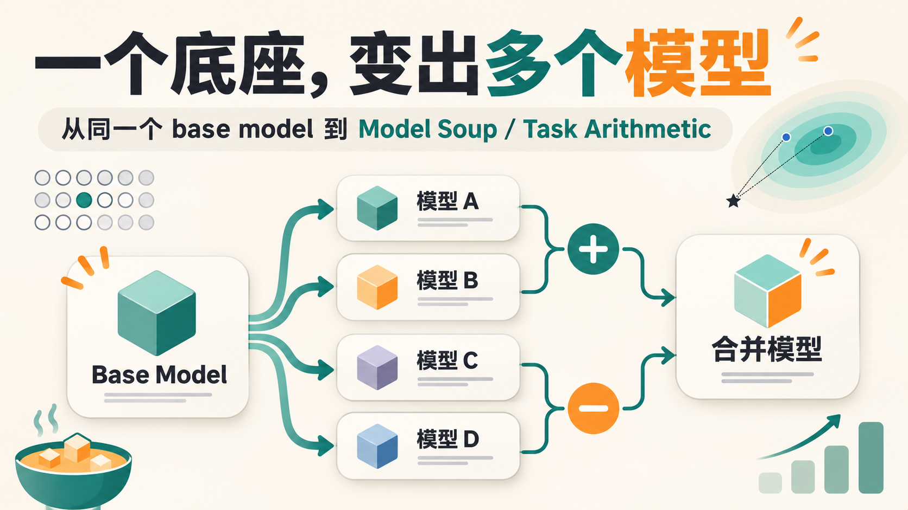
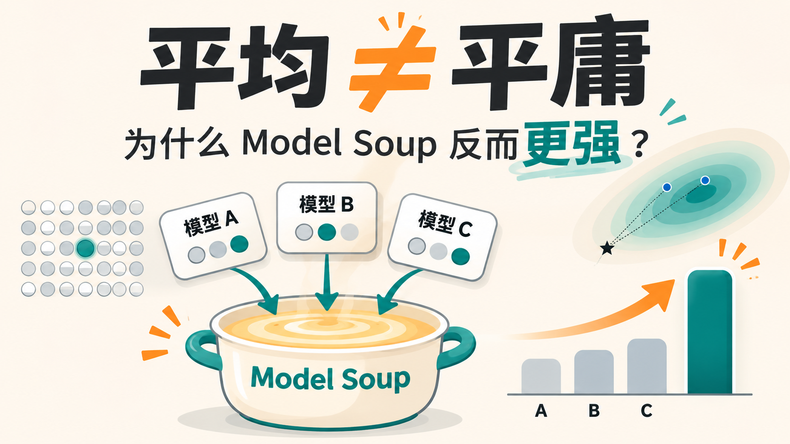

<!-- 待补：[方括号] 里是正式微调与合并实验跑完后填入的一手实测数字，以及 B 站发布后的备用链接。 -->

2026 年 10 月到 11 月的五周时间里，Google 连发了四个 Gemini 4 模型：Argon（10 月 13 日）、Carbon（11 月 10 日）、Hydrogen（11 月 12 日）和 Neon（11 月 18 日）。翻看官方公开的 model card，在 `Model dependencies` 一栏里能看到一条清晰的血缘链：Carbon `is based on` Argon，而 Hydrogen 与 Neon 都是 `adapted from` Carbon。

官方没有公开“adapted from”具体用了哪一种技术，所以没法从外部判断 Google 内部到底用了哪套做法。但这条公开的派生链提出了一个非常实际的工程问题：**当你手里已经有一个昂贵的预训练底座时，想快速派生出多个不同定位的模型，工程工具箱里到底有哪些牌？**

## 从一个底座派生模型的三条路

在训练完成后改造一个底座模型，主流手段大致分三类，各自解决不同约束：

| 手段 | 核心做法 | 硬件/架构约束 | 典型代价与适用场景 |
|---|---|---|---|
| **继续微调（SFT / RLHF / DPO）** | 在底座上继续跑梯度更新 | 同架构 | 需要目标任务数据与训练算力，适合把模型推向明确的新行为 |
| **蒸馏（Distillation）** | 让小模型模仿大模型的输出分布 | **可跨尺寸/架构** | 适合压缩延迟和定价；例如 Hydrogen 定价是 Neon 的一半，若两者参数规模不同，就只能走蒸馏或裁剪 |
| **权重合并（Model Merging）** | 不重新训练，直接对多个微调权重做平均或加减 | **必须同架构、同一预训练初始化** | 合并本身几乎零算力、推理成本不变；Meta 在 Llama 3 论文 §4.1.5 已明牌在 RM / SFT / DPO 各阶段使用权重平均 |

如果你还没看过权重合并这条路线的直觉演示，可以先看我做的这支 11 分钟动画视频，串讲了 **Model Soups**、**Task Arithmetic** 和 **TIES-Merging** 三篇奠基论文：

[B 站同步版（待发布后补链接）](https://www.bilibili.com/)

下面不再重复视频里讲过的动画直觉，直接聊两件视频因为篇幅砍掉的事：**2023 年之后的深水区进展**，以及**我在本地 M2 机器上亲手合并模型的实测**。

## 视频停住的地方：2023 年之后的两个关键追问

视频结尾提到，TIES-Merging 作者自己也坦承“权重线性插值为什么在深度网络里有效，理论上还没完全讲清楚”。如果顺着 2023–2024 年的后续论文往下追，有两个问题最值得工程人关注。

### 1. 任务向量能相加，真的只是“高维随机向量近似正交”吗？

Task Arithmetic 原论文用余弦相似度接近 0 来解释不同任务向量互不干扰。但仔细想会发现这个解释并不够硬——在几十亿维空间里，随便抽两个随机向量本来就近似正交，这并不足以保证把它们加回非线性神经网络后，特征表示不会互相打架。

Ortiz-Jimenez 等人在 NeurIPS 2023 的 *Task Arithmetic in the Tangent Space* 给出了更扎实的视角：真正的原因是**“各管一摊”**（论文叫权重解耦，weight disentanglement）。经过大规模预训练的模型，遇到汽车图片时调用的是网络里负责汽车的那一片反应区域，遇到动物图片时调用的是另一片区域——**两个任务在被输入触发时本来就不抢地盘**，所以把它们的参数改动加回同一个模型，彼此才不会互相破坏。只要微调步子迈得不大、模型行为离底座不远，这种“各管一摊”的性质就能保持得很好。

### 2. 放到大模型尺度上，这些精巧方法还拉得开差距吗？

TIES-Merging 之后，Yu 等人（2024）提出了 **DARE**（Drop And REscale）：极其反直觉地随机把 90% 甚至 99% 的微调参数改动量（也就是微调后权重减去底座权重的差值）直接归零丢掉，只把剩下的按比例放大，合并效果居然几乎不掉分——这从侧面印证了微调改动里的冗余度高得惊人。

但更值得看的是一篇 Google 参与的实证论文：Yadav 等人（2024）的 *What Matters for Model Merging at Scale?*（arXiv:2410.03617）。它直接把 Model Soups、Task Arithmetic、TIES 等方法拉到了大语言模型尺度上做横向评测。核心工程结论很清醒：**底座越强、规模越大，模型合并本身越容易成立，但各种复杂合并算法之间的差距反而会缩小。** 也就是说，在实际工程里，选对同一个强底座、管好微调超参，往往比死磕合并公式的细枝末节更重要。

## 本地实测：在 M2 16GB 上亲手合并两个任务

光读论文总归隔着一层纸。为了验证“按公式手写合并”和成熟工具 `mergekit` 在小模型上的真实表现，我在自己的 M2 MacBook（16GB 内存）上搭了一套最小实验（代码放在 [GitHub 仓库 `ai_research/02_model_merging`](https://github.com/zenXun/ai_research/tree/main/02_model_merging)）：

- **底座**：`HuggingFaceTB/SmolLM2-360M-Instruct`（3.62 亿参数，Apache-2.0）
- **两个任务**：`stanfordnlp/sst2`（情感二分类）与 `fancyzhx/ag_news`（新闻四分类），各取 500 条做评估
- **基线实测（未微调）**：
  - SST-2：50.4%（几乎全答 negative，等于瞎猜）
  - AG News：44.8%（随机瞎猜为 25%）
- **微调可行性验证**：全量微调在 batch size = 4 时占用约 6.1GB 内存、1.6 秒/步；40 步试跑就把 AG News 准确率从 44.8% 拉到了 81.8%，说明底座留给微调的提升空间足够大，实验信号不会淹没在噪音里。

接下来正式跑完两个任务的完整全量微调后，我会在这里补齐四组实测对账：

| 方案 | SST-2 准确率 | AG News 准确率 | 观察 |
|---|---|---|---|
| 预训练底座（无微调） | 50.4% | 44.8% | 已实测 |
| 单任务微调（SST-2 / AG News） | [待补] | [待补] | 正式微调后填入 |
| 直接线性平均（Linear / Model Soups 风格） | [待补] | [待补] | 观察跨任务直接平均掉分幅度 |
| TIES-Merging（手写实现 vs mergekit） | [待补] | [待补] | 观察修剪 + 投票救回多少分 |

同时还会实测两个任务向量之间的余弦相似度，以及 DARE 丢弃比例从 0% 扫到 99% 时的掉分曲线，看看论文里的漂亮曲线在 360M 小模型上到底几分真、几分假。

## 小结

模型权重合并不是取代训练的银弹——它至今绕不开“同架构、同初始化”的硬门槛，也打不过从头做的多任务联合训练。但它确实改变了我对模型权重的直觉：权重不再是只能通过昂贵反向传播去塑形的黑盒，在同一个预训练底座的局部邻域里，它更像一块可以做线性代数运算的乐高底板。

等本地实验跑完，我会把真实数字和代码复盘更新进上表。
