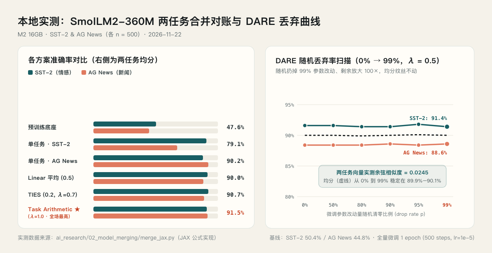

2026 年 10 月到 11 月的五周时间里，Google 连发了四个 Gemini 4 模型：Argon（10 月 13 日）、Carbon（11 月 10 日）、Hydrogen（11 月 12 日）和 Neon（11 月 18 日）。翻看官方公开的 model card，在 `Model dependencies` 一栏里能看到一条清晰的血缘链：Carbon `is based on` Argon，而 Hydrogen 与 Neon 都是 `adapted from` Carbon。

官方没有公开“adapted from”具体用了哪一种技术，所以没法从外部判断 Google 内部到底用了哪套做法。但这条公开的派生链提出了一个非常实际的工程问题：**当你手里已经有一个昂贵的预训练底座时，想快速派生出多个不同定位的模型，工程工具箱里到底有哪些牌？**

## 从一个底座派生模型的三条路

在训练完成后改造一个底座模型，主流手段大致分三类，各自解决不同约束：

| 手段 | 核心做法 | 硬件/架构约束 | 典型代价与适用场景 |
|---|---|---|---|
| **继续微调（SFT / RLHF / DPO）** | 在底座上继续跑梯度更新 | 同架构 | 需要目标任务数据与训练算力，适合把模型推向明确的新行为 |
| **蒸馏（Distillation）** | 让小模型模仿大模型的输出分布 | **可跨尺寸/架构** | 适合压缩延迟和定价；例如 Hydrogen 定价是 Neon 的一半，若两者参数规模不同，就只能走蒸馏或裁剪 |
| **权重合并（Model Merging）** | 不重新训练，直接对多个微调权重做平均或加减 | **必须同架构、同一预训练初始化** | 合并本身几乎零算力、推理成本不变；Meta 在 Llama 3 论文 §4.1.5 已明牌在 RM / SFT / DPO 各阶段使用权重平均 |

如果你还没有看过权重合并这条路线的相关论文，可以先看我做的这支 11 分钟动画视频，快速形成直觉——它串讲了 **Model Soups**、**Task Arithmetic** 和 **TIES-Merging** 三篇奠基论文：

[B 站同步版](https://www.bilibili.com/video/BV1FWynzWEpp)

下面不再重复视频里讲过的动画直觉，直接聊两件视频因为篇幅砍掉的事：**2023 年之后的深水区进展**，以及**我在本地 M2 机器上亲手合并模型的实测**。

## 视频停住的地方：2023 年之后的两个关键追问

视频结尾提到，TIES-Merging 作者自己也坦承“权重线性插值为什么在深度网络里有效，理论上还没完全讲清楚”。如果顺着 2023–2024 年的后续论文往下追，有两个问题最值得工程人关注。

### 1. 任务向量能相加，真的只是“高维随机向量近似正交”吗？

Task Arithmetic 原论文测出不同任务的向量余弦相似度接近 0，由此推论它们在合并时互不干扰。但仔细想会发现这个解释并不够硬：在几十亿维空间里，随便抽两个随机向量本来就近似正交；而神经网络是高度非线性的，参数空间里垂直，并不能自动保证它们算出来的输出不会互相污染。

Ortiz-Jimenez 等人在 NeurIPS 2023 Oral 论文 [*Task Arithmetic in the Tangent Space*](https://arxiv.org/abs/2305.12827) 里，分两步拆解了真正的原因：

1. **真正起作用的是“权重解耦（weight disentanglement）”**：与其只看参数向量夹角，不如拉回“输入 → 输出”的函数空间看。对一个经过大规模预训练的模型，顺着任务 A（比如识别汽车）的参数方向移动权重时，模型的输出只在“输入是汽车”的区域发生变化，在“输入是动物”的区域几乎不动；反之亦然。也就是说，预训练让不同的参数方向分别管着不同的输入领地，彼此不越界，这才是任务向量能直接相加而不打架的真正前提。
2. **为什么论文提出“切空间微调（Tangent Space）”**：此前大家默认常规微调步子小，模型行为已经近似线性了。但作者实测发现并非如此——常规微调依然带有明显的非线性漂移，会削弱“各管一摊”的解耦性质。于是作者提出改一改**微调方式**（而不是改合并公式）：把非线性神经网络在预训练起点 `θ₀` 附近做一阶泰勒展开（就像用起点处的切线去近似一条曲线），微调时强制只训练这个线性化的切线模型。因为模型输出对权重改动 `θ - θ₀` 变成了严格线性关系，后续把多个任务向量直接相加时，权重解耦显著增强，Task Arithmetic 的准确率也跟着明显提升。

### 2. 放到大模型尺度上，这些精巧方法还拉得开差距吗？

TIES-Merging 之后，Yu 等人在 ICML 2024 提出了 [**DARE**（*Language Models are Super Mario*）](https://arxiv.org/abs/2311.03099)：把微调带来的参数改动量（微调后权重减去底座权重的差值）随机清零 90% 甚至 99%，只把剩下的按比例放大，合并后效果居然几乎不掉分。

所谓“按比例放大”，做法和训练神经网络时熟悉的 Dropout 是一样的：假设随机丢弃比例是 `p`（比如 `p = 0.9`，丢掉 90% 的改动），直接加回底座的话整体改动幅度会缩水成原来的 1/10；于是把留下来的每一个非零改动都乘以 `1 / (1 - p)`（丢 80% 乘 5 倍，丢 90% 乘 10 倍），让改动总量的数学期望保持不变。这样做完后，每个模型的改动向量变得极其稀疏，多个任务合并时撞车的概率大幅下降。

但更值得看的是一篇 Google 参与的实证论文：Yadav 等人（2024）的 [*What Matters for Model Merging at Scale?*](https://arxiv.org/abs/2410.03617)。它直接把 Model Soups、Task Arithmetic、TIES 等方法拉到了大语言模型尺度上做横向评测。核心工程结论很清醒：**底座越强、规模越大，模型合并本身越容易成立，但各种复杂合并算法之间的差距反而会缩小。** 也就是说，在实际工程里，选对同一个强底座、管好微调超参，往往比死磕合并公式的细枝末节更重要。

## 本地实测：在 M2 16GB 上亲手合并两个任务

光读论文总归隔着一层纸。为了亲手验证按公式直接实现的合并与工业工具 `mergekit` 在小模型上的真实表现，我在自己的 M2 MacBook（16GB 内存）上搭了一套最小实验（代码放在 [GitHub 仓库 `ai_research/02_model_merging`](https://github.com/zenXun/ai_research/tree/main/02_model_merging)，微调跑在 PyTorch MPS 上，合并公式用 JAX 实现，再用 `mergekit` 对账）。

先交代实测范围与边界：这次实验直接验证了四篇论文的核心断言——**Model Soups**（直接平均）、**Task Arithmetic**（任务向量余弦相似度与缩放）、**TIES-Merging**（修剪投票能否救回掉分）和 **DARE**（随机丢弃 0%→99% 曲线）；至于上节提到的 **Tangent Space 显式线性化微调** 和 **7B+ 大尺度横向对比**，受限于 16GB 本地算力，本文只做论文梳理，不在本机复现。

- **底座**：`HuggingFaceTB/SmolLM2-360M-Instruct`（3.62 亿参数，Apache-2.0）
- **两个任务**：`stanfordnlp/sst2`（情感二分类）与 `fancyzhx/ag_news`（新闻四分类），各取 500 条做评估
- **微调设定与取舍**：两个任务各自从同一原始底座出发，做全量微调（不接 LoRA，与论文里的任务向量定义一致），只过 **1 轮、2000 条样本、batch size = 4（共 500 步）、学习率 `1e-5`**。之所以不训完整数据集（SST-2 有 6.7 万条、AG News 有 12 万条），一方面是因为之前 40 步试跑就已经拉出足够强的信号，另一方面更关键——模型合并成立的前提是微调权重不能漂移得离预训练底座太远，小学习率 + 1 轮刚好把模型留在底座附近的同一个损失盆地里；受 16GB 内存限制，单条输入截断到 128 token，batch size 卡在 4（占用约 6.1GB、约 1.6 秒/步，脚本设 9GB 熔断防换页）

### 全量实测结果与 `mergekit` 对账

| 方案 | SST-2 准确率 | AG News 准确率 | 两任务均分 | 核心观察 |
|---|---:|---:|---:|---|
| 预训练底座（无微调） | 50.4% | 44.8% | 47.6% | SST-2 抽查 200 条里 199 条全答 negative |
| 单任务微调 · SST-2 | 90.8% | 67.4% | 79.1% | 专精情感 |
| 单任务微调 · AG News | 88.0% | **92.4%** | 90.2% | 输出格式对齐顺手解锁了底座原有的情感能力 |
| Linear 平均（`alpha = 0.5`，JAX 实现） | 91.6% | 88.4% | 90.0% | SST-2 反而超过单任务最强（+0.8%），AG News 掉 4.0% |
| Linear 平均（`mergekit` 对账） | 91.6% | 88.4% | 90.0% | 与公式实现完全一致 |
| **Task Arithmetic（`lam = 1.0`，JAX 实现）** | 91.2% | 91.8% | **91.5%** | **全场最高均分**：两边同时逼近或超过单任务天花板 |
| TIES-Merging（`density = 0.2, lam = 0.7`，JAX 实现） | **92.4%** | 89.0% | 90.7% | SST-2 全场最高（+1.6%），但均分略输简单相加 |
| TIES-Merging（`mergekit` 对账） | **92.4%** | 88.6% | 90.5% | SST-2 一字不差，AG News 差 2 条样本（0.4%） |
| DARE（`drop = 0.99, lam = 0.5`，JAX 实现） | 91.4% | 88.6% | 90.0% | 随机清零 99% 改动、剩下放大 100 倍，均分纹丝不动 |

### 跑完实验后的三个真实发现

1. **为什么最简单的 `Task Arithmetic (lam = 1.0)` 反而赢了 TIES？**
   实测两个任务向量（`tau_sst2` 与 `tau_ag_news`）的全局余弦相似度只有 **`0.0245`**（正好落在 Task Arithmetic 论文图 5 的 `0.01–0.06` 区间里），L2 范数也很接近（3.53 vs 4.14）。因为只有两个几乎正交的任务、冲突极小，Linear 0.5 等于把双方信号白白砍了一半，TIES 强行砍掉 80% 也有轻微损耗；直接 `base + tau_a + tau_b`（`lam = 1.0`）反而拿到了全场最高的 **91.5% 均分**。这也正好印证了论文与视频里提到的：**TIES 不是每次都赢，它的主战场是 5–8 个以上多任务激烈冲突的场景。**
2. **DARE 在 362M 小模型上直接打脸了我的赛前直觉**：
   开跑前我原本预测：362M 参数只有前沿闭源模型的千分之一，每个参数压榨得更满、冗余度远低于 7B/70B，DARE 扫到 90%–99% 应该会提前崩盘。结果真实曲线是一条几乎笔直的横线：从 `drop = 0%` 到 `50% / 80% / 90% / 95% / 99%`，两任务均分依次是 **`90.0% → 90.0% → 89.9% → 90.0% → 90.1% → 90.0%`**。哪怕在 3.62 亿参数的小模型上，全量微调产生的微小改动依然极度冗余（当然边界也要说清：这里是相对简单的单 token 分类微调，换成长文本推理任务未必能扛到 99%）。
3. **只训新闻分类，为什么情感分类也从 50.4% 涨到 88.0%？**
   这不是模型从新闻里学会了电影影评，而是底座原本就懂情感，只是未微调时几乎全答 `"negative"`（格式与先验偏置没对齐）。两个任务共用同一套“只回答一个标签词”的对话模板，微调 AG News 时顺手解锁了底座按格式输出标签的能力。这个副产品提醒我：**做评测前一定要先看基线样本错在哪，不然很容易把“格式对齐”误读成“跨任务迁移”。**

## 小结

模型权重合并不是取代训练的银弹——它至今绕不开“同架构、同初始化”的硬门槛，也打不过从头做的多任务联合训练。但它确实改变了我对模型权重的直觉：权重不再是只能通过昂贵反向传播去塑形的黑盒，在同一个预训练底座的局部邻域里，它更像一块可以做线性代数运算的乐高底板——甚至把你微调出来的改动随机抹掉 99%，剩下的 1% 放大一百倍，依然能把两项任务稳稳托在 90%。
